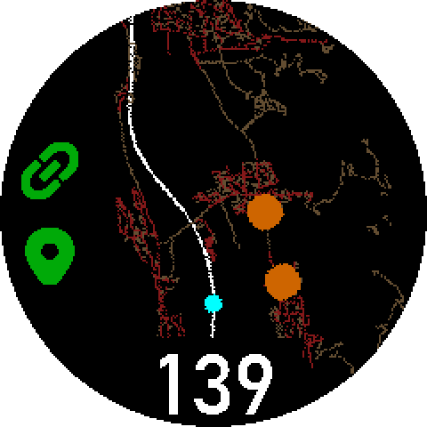
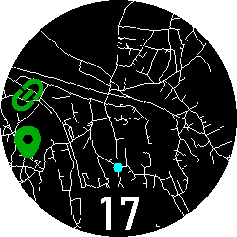
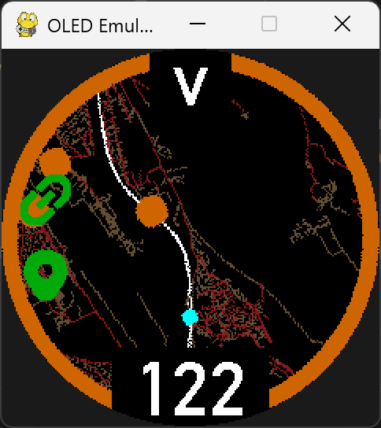
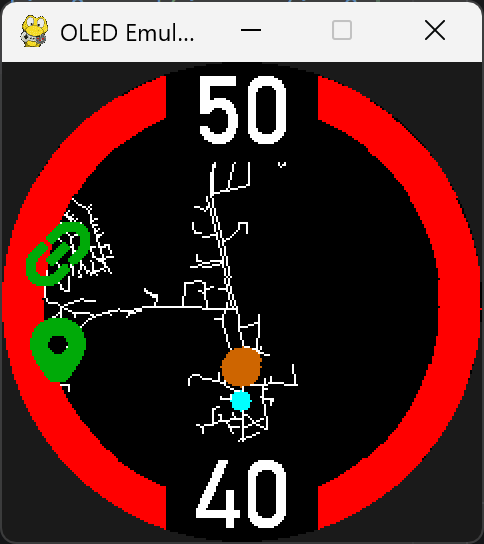

# NoYouWon't

**NoYouWon't** is a tiny driver-assistance gadget that brings a minimap-like view to your car. It is built around a Raspberry Pi Zero W, a GPS receiver, and a 240×240 pixel I²C OLED display. It displays the roads around you in real time and keeps an eye out for speed enforcement cameras so you don't have to.

|         <!-- -->         |         <!-- -->         |
|:------------------------:|:------------------------:|
|  |  |
|  |  |

### What it does

- Warns about fixed and mobile speed cameras
- Detects red-light cameras and section control zones
- Shows nearby roads with speed-dependent colouring
- Automatically adjusts map zoom based on your speed
- Optionally records driving data for later analysis

A minimalist navigation companion built for embedded hardware, focused on the information that matters most while driving.